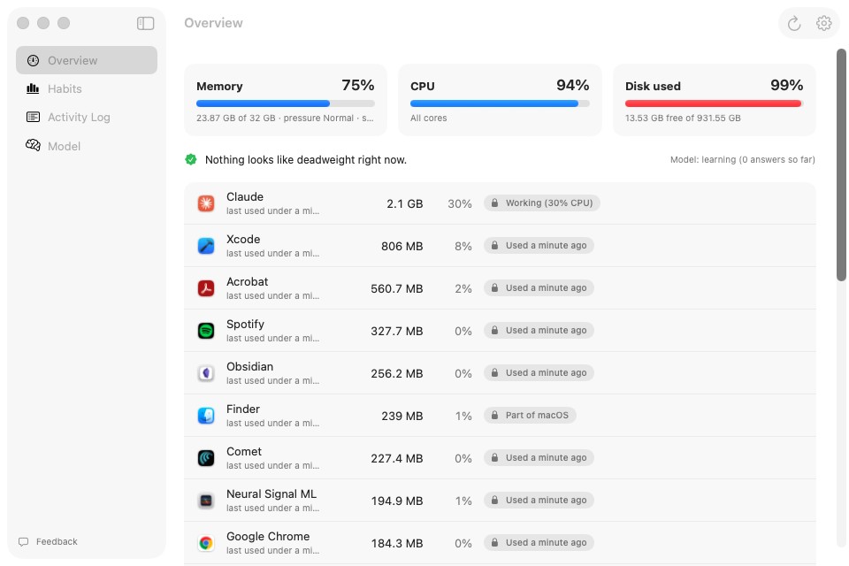
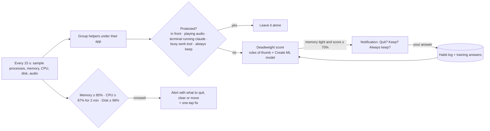
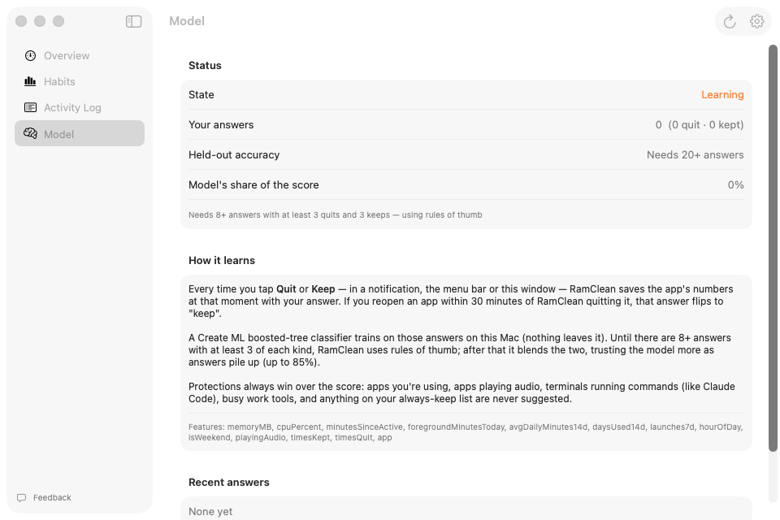
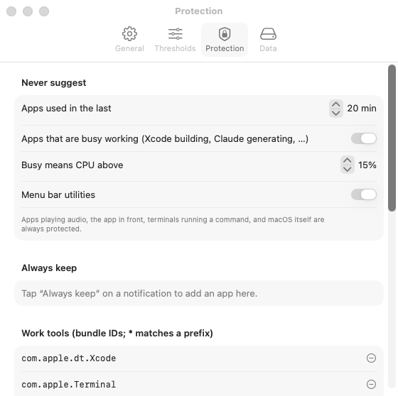

#  RamClean

A Mac menu bar app that spots apps eating memory you aren't using, asks before quitting them, and learns your habits so it stops asking about the ones you need.

**Free.** [Download the latest release](https://github.com/amalmehta/RamClean/releases/latest/download/RamClean.zip) (macOS 14 or later, Apple silicon and Intel), unzip it and drag RamClean to Applications. It isn't notarized yet, so the first time, right-click it and choose **Open**.

| Learns from your answers | Everything in one Settings window (⌘,) |
|---|---|
|  |  |

## Links

- [Setup, run and use](docs/INSTRUCTIONS.md)
- [System design](docs/SYSTEM-DESIGN.md)
- [What's where](docs/FILE-STRUCTURE.md)
- [Go-live checklist](docs/GO-LIVE.md): for a paid Pro version later (Developer ID, notarization, Lemon Squeezy and Sparkle); RamClean itself is free (`ProductConfig.isFree`)
- [Product website](site/index.html)
- [Project brief](RamClean.md)
