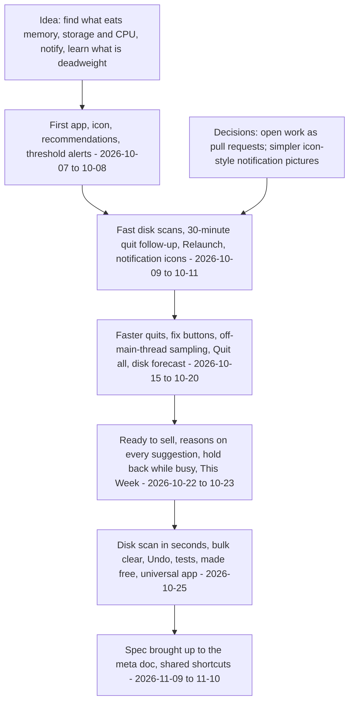
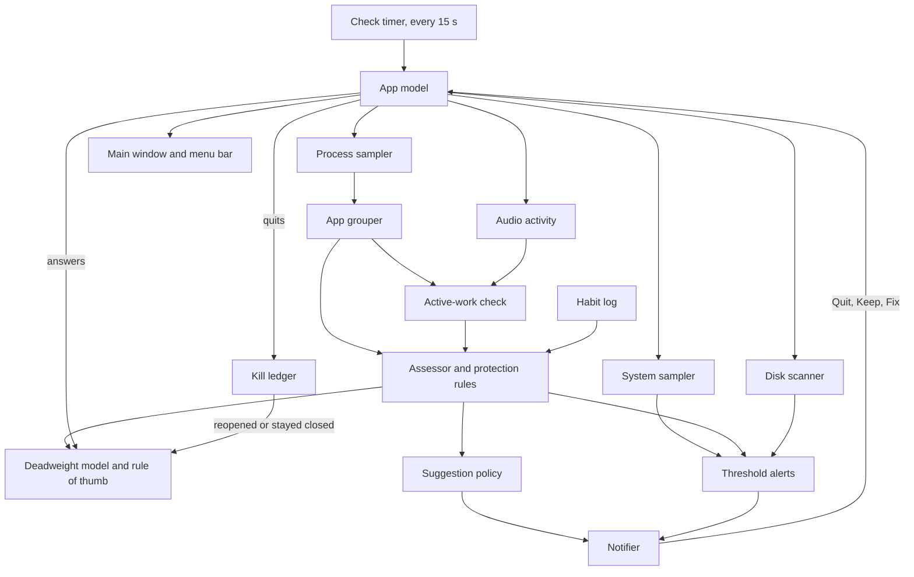
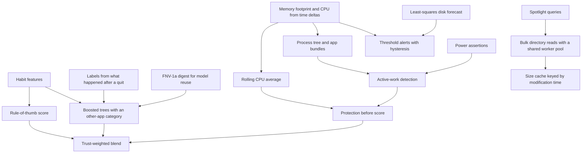

<!-- ProjectForge explainer at 4de2900 -->
# How RamClean was built

RamClean is a Mac app that finds what is using your memory, CPU and disk, and sends a notification when an app is worth quitting or a folder is worth clearing. It is for anyone whose Mac slows down or fills up, and it was built with developers in mind: a running build, a busy Claude Code session or music playing is never suggested. The idea that makes it work is to check hard rules first, then score each app with a small model trained only on your own answers. The model also counts as an answer whether you reopened an app soon after RamClean quit it.

## Build history

- **2026-10-07 to 10-08.** The first build: a memory monitor that learns which apps are deadweight (apps left running that you don't need). Then an app icon, later swapped for a ram mascot. Then recommendations behind the Memory, CPU and Disk bars, threshold alerts, and a faster "What to clear".
- **2026-10-09 to 10-11.** Disk scans got faster: steps run at the same time, sizes are read in bulk, and folder sizes are remembered across launches. RamClean began following each app it quit for 30 minutes to learn whether the quit was right. It now offers Relaunch after a quit and asks before quitting risky apps. Each kind of notification got its own picture. This work was merged as pull request #1.
- **2026-10-15 to 10-20.** Quitting got faster (PR #2). Each alert got its own fix button, low disk alerts fire at once, and dev apps are told apart (PR #3). Sampling moved off the main thread, and Quit all, Open at login and `build.sh --run` arrived (PR #4). A "deadweight" answer is now taken back if the quit never happened, and the model is only asked about apps that could be suggested (PR #5). Docker's disk image is now listed, and RamClean warns before the disk fills and offers to restart apps that have swollen.
- **2026-10-22 to 10-23.** RamClean was readied for direct sale, with a licence, a trial, updates and a release script, at $5 once instead of $14.99. Alerts can be paused, apps can be quit in bulk, and the trained model is reused at launch. Every quit suggestion now says why, suggestions wait while an app is busy, more reclaimable space is found and cleaned with each tool's own command, and a This Week summary was added.
- **2026-10-25.** The disk scan dropped to seconds, and several items can be cleared at once. The home walk, shared sizing and Select All Safe got tests. Undo, row ticking and category filters were added. RamClean was made free for everyone through `ProductConfig.isFree`, keeping the licence code for a later Pro version, and it now builds as a universal app.
- **2026-11-09 to 11-10.** The spec was brought up to the current meta doc, and the shared shortcuts were added.

## Code map

| Part | File | What it does |
|---|---|---|
| App model | `App/AppModel.swift` | Runs the timer, samples off the main thread, judges apps, quits them, records answers and retrains the model. |
| Process sampler | `RamCleanCore/Sources/RamCleanCore/ProcessSampler.swift` | Reads every process you own through libproc: parent, name, path, memory footprint and CPU %. |
| System sampler | `RamCleanCore/Sources/RamCleanCore/SystemSampler.swift` | Reads memory used, memory pressure, swap, total CPU and free disk. |
| Audio activity | `RamCleanCore/Sources/RamCleanCore/AudioActivity.swift` | Asks Core Audio which processes are playing sound. |
| App grouper | `RamCleanCore/Sources/RamCleanCore/AppGrouper.swift` | Folds helper processes into their app and links terminal commands to the app hosting them. |
| Active-work check | `RamCleanCore/Sources/RamCleanCore/ActiveWork.swift` | Marks an app busy when it is building, running Claude Code tasks, playing audio or keeping the Mac awake. |
| Habit log | `RamCleanCore/Sources/RamCleanCore/HabitStore.swift` | Stores time in front per day, launches and your answers, plus an event diary. |
| Features and rule of thumb | `RamCleanCore/Sources/RamCleanCore/Features.swift` | Turns one app at one moment into 12 numbers plus its ID, and gives a hand-written score. |
| Protection rules | `RamCleanCore/Sources/RamCleanCore/Protection.swift` | Hard "never suggest" rules, checked before any score. |
| Assessor and policy | `RamCleanCore/Sources/RamCleanCore/Assessor.swift` | Gives each app a verdict, picks at most one app to suggest, and averages CPU. |
| Deadweight model | `RamCleanCore/Sources/RamCleanCore/DeadweightModel.swift` | Trains a boosted-tree classifier on your answers and blends it with the rule of thumb. |
| Kill ledger | `RamCleanCore/Sources/RamCleanCore/KillLedger.swift` | Follows each quit for 30 minutes and turns what happened into a label. |
| Quit reason | `RamCleanCore/Sources/RamCleanCore/QuitReason.swift` | Writes the one-line "why" on each suggestion, at most 80 characters. |
| Threshold alerts | `RamCleanCore/Sources/RamCleanCore/Alerts.swift` | Decides when memory, CPU or disk crossed its line, and writes the alert and its fix. |
| Forecasts | `RamCleanCore/Sources/RamCleanCore/Forecast.swift` | Predicts when the disk will fill, and spots apps whose memory has swollen. |
| Disk scanner | `RamCleanCore/Sources/RamCleanCore/DiskScanner.swift` | Finds caches, old build folders, unused apps, old downloads, large files and the Trash. |
| Notifier | `App/Notifier.swift` | Sends notifications with action buttons and routes taps back to the app model. |
| Weekly summary | `RamCleanCore/Sources/RamCleanCore/WeeklySummary.swift` | Adds up a week of the event diary: memory freed, disk reclaimed, answers, reopened apps. |
| Licensing | `RamCleanCore/Sources/RamCleanCore/Licensing/ProductConfig.swift` | Selling settings; `isFree` is on, so nothing is locked. |
| Views | `App/MainView.swift`, `App/MenuBarView.swift`, `App/RecommendationViews.swift` | The main window, the menu bar menu and the per-bar recommendation lists. |

## Concepts

**Memory footprint and CPU from time deltas.** A process's *physical footprint* is the memory macOS counts against it, the same "Memory" number Activity Monitor shows. RamClean reads it with `proc_pid_rusage`, along with the total CPU time the process has used. CPU % is how much that CPU time grew since the last sample, divided by the wall-clock time between samples. A process that started since the last sample gets its average over its short life, so a new compile step doesn't read as idle. Lives in `RamCleanCore/Sources/RamCleanCore/ProcessSampler.swift`.

$$\text{cpu\%} = \frac{\Delta t_{\text{cpu}}}{\Delta t_{\text{wall}}} \times 100$$

Whole-machine "memory used" is app memory plus wired plus compressed pages, read with `host_statistics64`. Memory pressure comes from `kern.memorystatus_vm_pressure_level`. Lives in `RamCleanCore/Sources/RamCleanCore/SystemSampler.swift`.

**Process tree and app bundles.** Every process has a parent. Chrome runs as one main process and many "Chrome Helper" processes, each inside `Google Chrome.app`. RamClean groups a process under the *outermost* `.app` in its path, so nested helpers join their app. It scans the path's bytes for `.app/` because Foundation's `range(of:)` was most of the grouping time. For a terminal command like `claude`, it walks up the parent chain, at most 32 steps, to the app hosting it, such as Terminal or VS Code. Lives in `RamCleanCore/Sources/RamCleanCore/AppGrouper.swift`.

**Power assertions.** An app can tell macOS "don't sleep now"; that request is a power assertion. `pmset -g assertions` lists them by process. RamClean parses that text, gives up after 2 seconds so a stuck `pmset` can't stall sampling, and reads `Created for PID` (coreaudiod holds assertions for the app that is playing) and `audio-out` resources. Lives in `RamCleanCore/Sources/RamCleanCore/ActiveWork.swift` (`PowerAssertions`).

**Active-work detection.** This answers "is this app in the middle of something?" from one sample. For each Dock or menu bar app, it collects every process started under it, then checks in order of how sure each sign is: a remote build client (`docker-buildx`, `buildctl`) at any CPU; a build tool (`clang`, `swift-frontend`, `cargo`, `node` and others) at 10% CPU or more; a `claude` process with a child at 3% CPU or more; audio; a sleep assertion. `ActiveWorkTracker` keeps an app busy for 2 minutes after the last sign, because compilers come and go between samples and songs have gaps. This is how "don't kill a Claude Code build or Spotify while it plays" is enforced. Lives in `RamCleanCore/Sources/RamCleanCore/ActiveWork.swift`.

**Rolling CPU average.** The CPU average for each app is taken over its last 12 samples, about 3 minutes at the default 15-second check, so one spike doesn't count. A work tool such as Xcode or Terminal averaging 15% or more is treated as busy. Lives in `RamCleanCore/Sources/RamCleanCore/Assessor.swift` (`CPUHistory`) and `RamCleanCore/Sources/RamCleanCore/Preferences.swift`.

**Protection before score.** Some apps must never be suggested, whatever any score says. `ProtectionRules.reason` checks, and the first match wins: command-line tool, background process, menu bar app (unless you include them), RamClean itself, macOS apps and paths, your always-keep list, busy, frontmost, hosting terminal work, busy work tool, and used in the last 20 minutes. An app RamClean has never seen in front is shown as "still learning" instead. Protected apps skip the model entirely, which also saves time. Lives in `RamCleanCore/Sources/RamCleanCore/Protection.swift` and `Assessor.swift`.

**Habit features.** The model needs numbers, not apps. `FeatureVector` describes one app at one moment with 12 numbers: memory, average CPU, minutes since active, minutes in front today, average daily minutes over 14 days, days used out of 14, launches in 7 days, hour, weekend, playing audio, times kept and times quit. The app's ID is added as a category. Time in front only counts if there was keyboard or mouse input in the last 2 minutes (`AppModel.creditForeground`). An app never seen in front counts as idle since RamClean started watching, capped at 14 days, so a fresh install doesn't flag everything. Lives in `RamCleanCore/Sources/RamCleanCore/Features.swift` and `HabitStore.swift`.

**Rule-of-thumb score.** Before there are enough answers, a hand-written score from 0 (keep) to 1 (deadweight) does the job. Idleness raises it on a log scale, from 15 minutes (0) to 6 hours (1). Heavy daily use and many days used lower it, audio lowers it a lot, and your past answers about the app pull it toward them. Here $m$ is minutes idle, $a$ the average daily minutes, $d$ the days used out of 14, $n$ your answers about the app and $q$ the share of them that were quits; $\operatorname{clip}$ limits a value to the range 0 to 1:

$$\text{idle} = \operatorname{clip}\!\left(\frac{\ln(\max(m,1)/15)}{\ln(360/15)}\right),\quad \text{habit} = 0.6\,\operatorname{clip}(a/60) + 0.4\,\operatorname{clip}(d/10)$$

$$p = 0.15 + 0.8\,\text{idle} - 0.45\,\text{habit} - 0.5\,[\text{audio}],\qquad p \leftarrow (1-u)\,p + u\,q,\quad u = 0.5\,\operatorname{clip}(n/5)$$

The result is clipped to 0.01 to 0.99. Lives in `RamCleanCore/Sources/RamCleanCore/Features.swift` (`HeuristicScorer`).

**Boosted trees with an other-app category.** A boosted-tree classifier is a chain of small decision trees, each one fixing the errors of the ones before it. It handles rules like "idle *and* rarely used" that a straight weighted sum can't. RamClean uses Create ML's `MLBoostedTreeClassifier` with depth 4, 40 iterations and a fixed seed. Create ML refuses app IDs it hasn't seen, so every answer is trained twice: once under its real ID and once as `_other`. Apps you never answered about are scored as `_other`, so the model learns both "you always keep Spotify" and a general pattern. It trains only with at least 8 answers, including 3 quits and 3 keeps. With 20 or more, every fifth answer is held out to measure accuracy, then the model is retrained on all of them. Lives in `RamCleanCore/Sources/RamCleanCore/DeadweightModel.swift`.

**Labels from what happened after a quit.** Tapping Quit is an answer, but a weak one. `KillLedger` follows each quit for 30 minutes. If you reopen the app in that window, the answer is relabelled `keep` and logged as a regret. If the app never actually quit, for example because you cancelled its save dialog, the `deadweight` answer is removed, since it taught nothing true. The ledger is saved to `kills.json`, so a restart doesn't lose it. Lives in `RamCleanCore/Sources/RamCleanCore/KillLedger.swift`, used in `App/AppModel.swift` (`resolve`).

**Trust-weighted blend.** A model trained on a handful of answers is mostly noise, so its weight grows with the number of answers $n$, up to a cap. Here $p_{\text{model}}$ is the model's probability of deadweight and $h$ is the rule-of-thumb score. An app is called deadweight when the result is 0.7 or more (`deadweightThreshold`).

$$w = \min\!\left(0.85,\ \frac{n}{40}\right),\qquad \text{score} = w\,p_{\text{model}} + (1-w)\,h$$

Lives in `RamCleanCore/Sources/RamCleanCore/DeadweightModel.swift` (`score`, `train`).

**FNV-1a digest for model reuse.** FNV-1a is a simple hash: for each byte, XOR it in, then multiply by a fixed prime. RamClean hashes all training answers (as sorted-key JSON) and saves the hash next to the compiled model. At launch, if the hash still matches, it loads the saved model instead of spending a second or more retraining. Lives in `RamCleanCore/Sources/RamCleanCore/DeadweightModel.swift` (`digest`, `restoreSaved`).

$$h_0 = \texttt{0xcbf29ce484222325},\qquad h \leftarrow (h \oplus b) \times \texttt{0x100000001B3} \bmod 2^{64}$$

**Threshold alerts with hysteresis.** Hysteresis means the line for "back to normal" sits lower than the line for "alert", so a value hovering at the line doesn't fire again and again. `ThresholdMonitor` alerts when memory passes 85%, CPU 97% or disk 99% used. CPU must stay over for 2 minutes. While a resource stays over, it alerts again at most once an hour, and it re-arms only after dropping 3 points below the line. Each alert names what to quit, restart or clear, with a one-tap fix. Lives in `RamCleanCore/Sources/RamCleanCore/Alerts.swift`.

**Least-squares disk forecast.** To warn before the disk is full, RamClean keeps a free-space sample every 30 minutes for 14 days. It fits a straight line through the last 3 days, with time $x$ in days and free bytes $y$. It needs at least 12 hours of data and ignores losses under 250 MB a day. If the floor is reached within 3 days, it warns, at most once a day.

$$b = \frac{\sum (x_i-\bar x)(y_i-\bar y)}{\sum (x_i-\bar x)^2},\qquad \text{days left} = \frac{\text{free} - \text{floor}}{-b}$$

The same file spots apps whose memory has at least doubled, and grown by at least 1 GB, after being watched for 30 minutes since their low point. Restarting one of these is offered instead of quitting it. Lives in `RamCleanCore/Sources/RamCleanCore/Forecast.swift`.

**Bulk directory reads with a shared worker pool.** Measuring a folder normally means one `stat` call per file. `getattrlistbulk` returns the names, types and allocated sizes of many entries in one call, packed into a buffer. RamClean reads that buffer field by field with unaligned loads, because entries sit on 4-byte boundaries. `walkFolders` runs one worker per core (at least 4). The workers share one list of folders still to read, guarded by a condition variable, and each reuses a 64 KB buffer. Because every tree feeds one list, a single huge folder is spread across all workers. A comment in the code records that splitting work per folder ran 2 to 5 times slower on a busy Mac. Lives in `RamCleanCore/Sources/RamCleanCore/DiskScanner.swift` (`walkFolders`, `forEachEntry`, `allocatedSizes`).

**Size cache keyed by modification time.** A folder's own modification time changes when something is added, removed or renamed directly inside it. `SizeCache` reuses a remembered size while that time is unchanged and the size is under 6 hours old. Rescan turns reuse off. Sizes are saved to `sizes.json`, so a relaunch doesn't start from zero. `ScanMemory` does the same for the last walk of the home folder and the simulator list. Lives in `RamCleanCore/Sources/RamCleanCore/DiskScanner.swift`.

**Spotlight queries.** Spotlight is macOS's file index. When it indexes the home folder, RamClean asks it, through `MDQuery`, for files of 1 GB or more, project marker files and `node_modules` folders, running the queries side by side. With indexing off, Spotlight returns nothing rather than an error, so RamClean falls back to the bulk walk. Spotlight's last-used date (`kMDItemLastUsedDate`) also decides which apps in `/Applications` count as unused. Lives in `RamCleanCore/Sources/RamCleanCore/DiskScanner.swift` (`homeIndex`, `spotlightIndex`, `Spotlight`).

## One input, start to finish

The input: Google Chrome has sat in the background for three hours, using 2 GB, while memory is 85% full.

1. **The timer fires.** `AppModel.scheduleTimer` (`App/AppModel.swift`) runs `tick` every 15 seconds (`Preferences.checkInterval`), or every 60 seconds in Low Power Mode. `tick` skips the check if the last one is still sampling.
2. **Sample off the main thread.** On `samplingQueue`, `tick` calls `SystemSampler.sample` (memory 85%, pressure, disk) and `ProcessSampler.sample` (every Chrome process with its footprint and CPU %).
3. **Group.** `AppGrouper.group` (`AppGrouper.swift`) folds every "Google Chrome Helper" into one `AppGroup` keyed by `Google Chrome.app`, adding up memory and CPU. Chrome has a Dock icon, so its kind is `.app`.
4. **Busy check.** `AudioActivity.pidsPlayingAudio` and `PowerAssertions.read` feed `ActiveWorkTracker.update` (`ActiveWork.swift`). Chrome has no build tool, no agent, no audio and no sleep assertion, so it isn't busy.
5. **Judge on the main thread.** `AppModel.assess` credits foreground time (`creditForeground`) and updates `CPUHistory.record`. It then runs `Assessor.assess` (`Assessor.swift`). For Chrome, `HabitStore.stats` gives 180 minutes idle and its 14-day usage, and `FeatureVector.make` builds the 12 numbers.
6. **Protection.** `ProtectionRules.reason` (`Protection.swift`) finds nothing: Chrome isn't frontmost, isn't on the always-keep list, hosts no terminal work and was last used more than 20 minutes ago.
7. **Score.** `DeadweightModel.score` (`DeadweightModel.swift`) computes `HeuristicScorer.score`. If the model is trained, it also asks it for a probability, passing Chrome's ID or `_other`, and blends the two. A score of 0.7 or more gives the verdict `.deadweight`.
8. **Pick.** `SuggestionPolicy.pick` (`Assessor.swift`) checks that notifications are on, that no suggestion went out in the last 10 minutes, and that Chrome wasn't asked about in the last 4 hours. Memory is tight (85% ≥ 80%) and Chrome is over 400 MB, so it qualifies. Among the apps that qualify, it picks the largest memory × score.
9. **Notify.** `AppModel.suggest` writes the body with `QuitReason.text` (`QuitReason.swift`), for example "Idle 3 h, 2 GB, barely used this week." `Notifier.suggest` (`App/Notifier.swift`) sends "Quit Google Chrome?" with Quit, Keep running and Always keep. The `.suggested` event goes to `events.jsonl` via `HabitStore.log`.
10. **You tap Quit.** `Notifier.userNotificationCenter(_:didReceive:)` calls `AppModel.handle(.quit)`, which calls `AppModel.quit`. That checks for unsaved windows through Accessibility (`hasUnsavedDocuments` reads `kAXEditedAttribute`) and asks first if there are any. Then it calls `terminate()` on each Chrome instance.
11. **Record the answer.** In the same task, `KillLedger.recordKill` starts the 30-minute follow-up. `AppModel.record` adds a `deadweight` example to `training.jsonl` via `DeadweightModel.add`. `HabitStore.recordDecision(.quitBySuggestion)` updates Chrome's answer history. `watchQuit` offers Force Quit if Chrome stops answering for 3 seconds in a row, or is still running after 10 seconds.
12. **Chrome exits.** The workspace terminate observer in `observeWorkspace` calls `KillLedger.noteTerminated`, then `announceQuit`, which sends "Quit Google Chrome" with the memory freed and a Relaunch button (`Notifier.quitDone`).
13. **Retrain.** `scheduleRetrain` waits 15 seconds, then `retrain` runs `DeadweightModel.train` on a background queue. If training succeeds, the compiled model is saved with its FNV-1a digest.
14. **The 30 minutes close.** If you reopen Chrome in time, `AppModel.launched` gets `.relaunched` from `KillLedger.noteLaunch`. `resolve` then logs a regret and calls `DeadweightModel.relabelLatest(... to: .keep)`, so the model learns you wanted it. If you don't, `KillLedger.expire` on a later check returns `.stayedClosed`, which confirms the `deadweight` label. If Chrome never quit, the outcome is `.neverQuit` and `DeadweightModel.removeLatest` takes the answer back.

## Where this came from

Written from the spec, the decisions, git history and the code as of the latest commit (4de2900, 2026-11-10).
