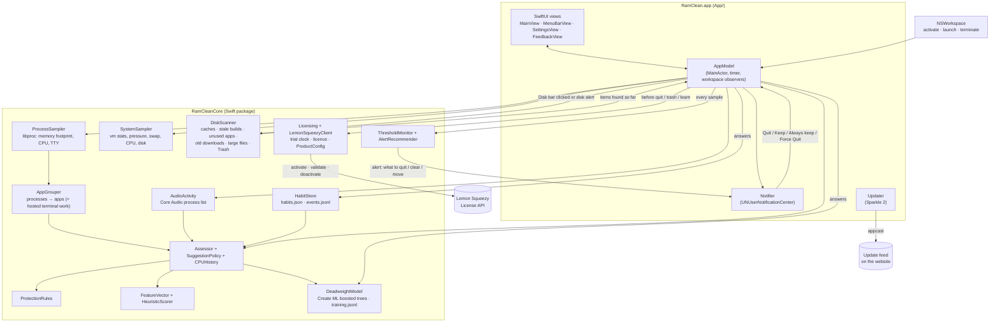
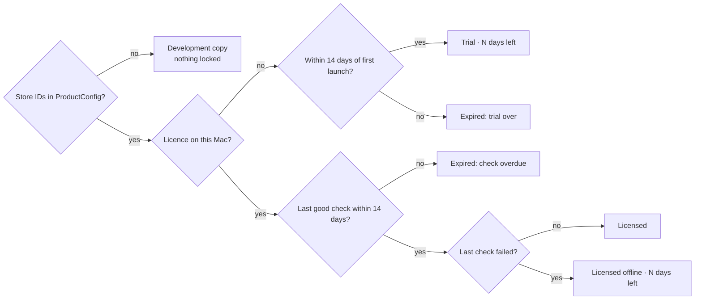

# RamClean — System Design

RamClean is a native SwiftUI Mac app with a menu bar item, one main window and a Settings window. All of its logic lives in a Swift package, **RamCleanCore**, which has no UI code, so it can be tested with `swift test`. The app target is a thin layer on top: AppKit and SwiftUI, notifications, and the timer.

## Architecture

## Components

| Component | Job |
|---|---|
| `ProcessSampler` | Lists every PID with `proc_listallpids`. For each one it reads `proc_pidinfo` (parent, uid, name, whether it has a terminal) and `proc_pid_rusage` (physical footprint, the same "Memory" number Activity Monitor shows; CPU time). CPU % is the CPU-time delta between samples. Processes owned by other users can't be read and are skipped. |
| `SystemSampler` | Memory used (app + wired + compressed, matching Activity Monitor), `kern.memorystatus_vm_pressure_level`, `vm.swapusage`, total CPU from host tick deltas, and free disk from `volumeAvailableCapacityForImportantUsage`. |
| `AudioActivity` | Reads Core Audio's process objects (macOS 14+) and returns the PIDs currently playing audio. |
| `AppGrouper` | Folds helpers into their app using the outermost `.app` in the executable path (every "Chrome Helper" becomes Chrome). Classifies each group as a Dock app, menu bar app, command-line tool or background process. For each non-shell terminal process (e.g. `claude`), it walks up the parent chain to the app hosting it (Terminal, iTerm, VS Code…) and records it as hosted work. |
| `HabitStore` | The habit log. It records time each app spends in front, per day, launches, when each app was last active, and your answer counts. It also appends a JSON-lines event diary. |
| `ProtectionRules` | Hard "never suggest" rules, checked before any score (see below). |
| `FeatureVector` | Twelve numbers plus the app ID describing an app at one moment: memory, average CPU, minutes idle, foreground minutes today, average per day over 14 days, days used out of 14, launches in 7 days, hour, weekend, playing audio, times kept, times quit. |
| `HeuristicScorer` | Rule-of-thumb deadweight score from 0 to 1. Idleness raises it (on a log scale from 15 minutes to 6 hours); daily use and many days used lower it; audio lowers it; your past answers about the app pull it toward them. |
| `DeadweightModel` | Create ML `MLBoostedTreeClassifier` (depth 4, 40 iterations) trained on `training.jsonl`. It returns the probability of "deadweight" through the compiled `MLModel`. |
| `Assessor` | For each group: features, protection, score, then a verdict of `protected(reason)`, `deadweight` or `keep`. |
| `SuggestionPolicy` | Decides whether to notify now, and about which app (the largest memory × score that passes the thresholds and cooldowns). |
| `CPUHistory` | Rolling average over the last 12 samples, so a single spike doesn't count as "busy". |
| `DiskScanner` | Read-only scan for space you could free. It measures a fixed list of rebuildable developer and tool caches, every child of `~/Library/Caches` and `~/.cache` over 200 MB, files of 1 GB or more in your home folder (skipping `~/Library`, hidden folders, inside app bundles, and anything already listed), and the Trash. Each item gets a reason, an optional caution, and a "can trash" flag. It reports items as each step finishes. |
| `DiskScanner` (stale and active rules) | Also finds build and dependency folders in code projects (found by marker files like `package.json` or `Cargo.toml`) with no changes for `activeDays` (30), apps in `/Applications` not opened in `staleDays` (90) by Spotlight's `kMDItemLastUsedDate`, and old big things in `~/Downloads`. Anything touched within `activeDays` counts as live work and is skipped: projects, build folders written to recently, and files opened or changed recently. Large files not opened in `staleDays` are tagged to move off the Mac. |
| Scan speed | Large files and code projects come from **Spotlight** (`MDQuery`: `kMDItemFSSize ≥ 1 GB`, and project marker file names), so the home folder isn't walked; if Spotlight can't answer (indexing off), it falls back to walking. **Independent steps run at the same time** (caches, unused apps, old downloads, Trash and the Spotlight queries), and only large files and build folders wait for them. Folder sizes use **`getattrlistbulk`**, one call per batch of directory entries, with the first two levels of subfolders measured in parallel; it falls back to fts. **`SizeCache`** remembers each folder's size and modification time, so refreshes re-measure only what changed (for up to 6 hours; Rescan measures everything). It's saved to `sizes.json`, so a relaunch or reboot doesn't start from zero. Each cache appears in the list as soon as it's measured. The app keeps the last report in `disk-report.json`. |
| Disk popover | Starts with `DiskReport.totals` (space you could win per category, counting only actionable items) and `biggestWins()` (top 3 single items). Rows are in a `LazyVStack`, so only visible ones are built. Icons come from `DiskIcons`, one per file type (cached), with real icons only for apps and the Trash. While a scan streams in, the list redraws at most 4 times a second. |
| `ThresholdMonitor` | Watches memory %, CPU % and disk % used against your thresholds (85 / 97 / 99). CPU must stay over for 2 minutes. It reminds at most every 60 minutes while over, re-arms after dropping 3 points below the line, and supports per-resource snooze. |
| `AlertRecommender` | Writes each alert's title and text and picks its one-tap fix. Memory and CPU: idle unprotected apps (deadweight first), else the busiest app and why it's protected. Disk: the biggest rebuildable items, unused apps, and files to move. The fix is quitting the top app or trashing the biggest rebuildable item. |
| `Assessment.reasons` | Short "why" phrases for the recommendation lists: protection reason, idle time, daily use, CPU, and your past answers. |
| `AppModel` | Runs the timer, credits foreground time, observes app launch, quit and activation, quits apps (`terminate`, then optionally `forceTerminate`), records answers, retrains the model in the background, and publishes state to SwiftUI. |
| `Notifier` | Notification categories with action buttons; routes taps back to `AppModel`. |
| `ProductConfig` | Every selling and update setting in one place: price, trial days, offline grace, re-check interval, checkout link, website, appcast URL, Lemon Squeezy store and product IDs. |
| `Licensing` | The trial clock and the activated licence, stored twice (Keychain and UserDefaults), and the state the UI shows: trial with days left, licensed, licensed offline (grace), expired, or "development copy" while `ProductConfig` has no store. |
| `LemonSqueezyClient` | Activate, validate and deactivate a key with Lemon Squeezy's public License API, through an `HTTPClient` protocol (a fake in tests). It tells "the server said no" apart from "couldn't reach the server", and refuses keys from any other store or product. |
| `Updater` | Starts Sparkle's standard updater with the feed from `ProductConfig`, only once both the feed and `SUPublicEDKey` are filled in. |

## Main flows

**Each check** (every 15 seconds by default):
1. Credit the frontmost app with the time since the last check. This only counts if there was keyboard or mouse input in the last 2 minutes.
2. Sample processes and system stats, group the processes, and update CPU averages.
3. For each group, `Assessor` builds features from `HabitStore`. It checks `ProtectionRules`, then scores the app with the heuristic blended with the model.
4. `SuggestionPolicy.pick` runs. If it returns an app, `Notifier` sends "Quit X?" and the event is logged.
5. The disk check runs, with at most one warning a day.

**Protection order** (first match wins): command-line tool → background process → menu bar app (unless included) → RamClean itself → macOS system app or path → always-keep list → frontmost → playing audio → hosting terminal work (e.g. `claude` in Terminal) → busy work tool (average CPU ≥ 15%) → used within 20 minutes (shown as "still learning" if RamClean has never seen the app in front).

**Answer → learning:**
- **Quit:** records a `deadweight` example with the app's current features, logs it, calls `terminate()`, and offers Force Quit if the app is still running after N seconds.
- **Keep / Always keep:** records a `keep` example. "Always keep" also adds the app to the list.
- **Regret:** if an app RamClean quit is opened again within 30 minutes, its latest example is relabelled `keep`.
- After every answer the model retrains on a background queue; it takes about a second.

**Threshold alerts:** every check feeds the system numbers into `ThresholdMonitor`. For each resource it reports, `AlertRecommender` writes the notification.

The disk alert uses a scan from the last 6 hours, or starts one and sends the alert when it finishes. The notification's fix button is re-registered with its current label ("Quit Spotify") just before sending. Tapping it quits the app (polite first) or trashes the cache. **Show recommendations** opens the window on that bar's popover; **Snooze** silences the resource for an hour.

**Move to…:** for large files and old downloads. It lists external, writable, browsable volumes plus a folder picker, checks the destination has room, then calls `FileManager.moveItem`. Across drives that's a copy followed by removing the original, so a failed copy leaves the original where it was. The move is logged as `movedOffMac`.

**Recommendations (clicking a bar):** Memory and CPU show Dock apps ranked by that resource with their verdict, reasons, and Quit / Keep buttons; those buttons feed the model exactly like notification answers do. Disk runs `DiskScanner` on a background queue, and its results stream into the popover. **Move to Trash** asks first, then calls `FileManager.trashItem` (recoverable), logs a `movedToTrash` event and refreshes.

**Scoring blend:** `score = w × model + (1 − w) × heuristic`, where `w = min(0.85, answers / 40)`.

The model trains only once there are at least 8 answers, with at least 3 quits and 3 keeps; until then `w = 0`. With 20 or more answers, every fifth answer is held out to report accuracy, then the model is retrained on all of them.

## Selling, licensing and updates

**States.** `Licensing.state()` works from two stored dates and the licence record:

Expired copies keep sampling, scoring, recommending and alerting. Quitting and restarting apps, moving files to the Trash or off the Mac, and learning from Keep and Quit answers go through `AppModel.allowed(_:)`, which shows "needs a licence" with **Buy** and **Enter Licence Key…** instead. "Always keep" still adds the app to the list (it's a protection), but isn't learned from.

**Checks.** At launch and then every 24 hours a licensed copy validates its key; after a failed check it retries hourly. Network errors, timeouts, rate limiting (429) and server errors (5xx) count as offline and start the grace period. A clear "no" (refunded, disabled, deactivated from Lemon Squeezy's dashboard, or another product's key) removes the licence and says why in Settings → Licence.

**Release.** `scripts/release.sh` archives Release with the hardened runtime, re-signs Sparkle's helpers and then the app with the Developer ID certificate, notarizes and staples the app, then builds, signs, notarizes and staples a DMG. It refuses to start without the certificate and notary profile, or while `ProductConfig` still has placeholders.

## Where data lives

- `~/Library/Application Support/RamClean/`: `habits.json`, `events.jsonl`, `training.jsonl`, `meta.json`, `feedback.jsonl`. See [INSTRUCTIONS.md](INSTRUCTIONS.md#where-your-data-lives).
- `UserDefaults` key `RamCleanPreferences`: the whole `Preferences` struct as JSON. Decoding fills in defaults for missing keys, so a new setting never wipes the old ones.
- Trial clock and licence: Keychain items under service `com.amalmehta.RamClean.licence` (`trialStart`, `lastSeen`, `licence`), mirrored in `UserDefaults` keys `RamCleanLicensing.*`.
- The trained model lives only in memory. It's rebuilt from `training.jsonl` at launch, which takes about a second.

## Key decisions and trade-offs

- **Create ML boosted trees, not a hand-written model.** You chose this. It handles mixed numeric and categorical features and nonlinear rules like "idle *and* rarely used". The costs: it's less explainable than logistic regression, and it links the CreateML framework.
- **The app ID is a model feature, with an `_other` copy.** Create ML refuses categories it hasn't seen, so every answer is also trained as `_other`, and unseen apps are scored as `_other`. The model learns both "you always keep Spotify" and a general pattern.
- **Rules of thumb first, model later.** A model trained on three answers is noise. The blend ramps up trust as answers accumulate, and protections always override the score.
- **Never suggest command-line tools or background processes.** Killing a terminal process can lose work (an idle Claude Code session still holds its conversation), and launchd restarts most agents anyway. Instead, the app hosting them is protected.
- **"Busy" is judged by CPU, and only for work tools.** A browser tab burning CPU while you're away is exactly the deadweight to catch. Xcode or Claude at high CPU is working. The work-tool list is editable.
- **Quit politely first.** `terminate()` lets apps save or prompt. Force Quit is a separate, explicit second step.
- **Idle time for apps never seen in front counts from when RamClean started watching**, not "forever". Otherwise a fresh install would flag every app as deadweight.
- **Stable row order.** Rows re-sort at most once a minute and never under the pointer. Found in testing: re-sorting between aiming and clicking made a click hit a neighbouring app.
- **Regular app with a Dock icon, plus a menu bar item.** This makes ⌘, and the main window behave normally. A menu-bar-only (`LSUIElement`) build would be a small change.
- **Disk: Move to Trash only.** Nothing is deleted permanently, and every move is confirmed and logged. Only rebuildable caches are labelled safe; large files are listed with what they look like, and you decide. Simulator devices are advice only, because trashing their folder behind `simctl`'s back corrupts Xcode's device list.
- **Active work is off-limits by recency, not guesswork.** A project, build folder or file touched in the last 30 days is never suggested, so a project being built or a document you're editing never shows up. The trade-off: a project paused for 29 days isn't flagged yet.
- **Unused apps rely on Spotlight's last-used date.** Apps with no record are left alone rather than guessed at, and Apple apps are never listed.
- **One-tap fixes stay recoverable.** A notification can quit an app (politely) or trash a *rebuildable* item. Uninstalling apps, trashing downloads and moving files always happen in the window, with a confirmation.
- **Spotlight first for the home folder.** Walking a home folder on a busy Mac took over 10 minutes; Spotlight answers the same questions in seconds, and also finds big bundles (VMs, Final Cut libraries) the walk skipped. The trade-off: folders Spotlight doesn't index (excluded in System Settings, or external) aren't searched unless Spotlight is off entirely.
- **Stale-while-refreshing.** The popover always opens with the last results and refreshes in the background when they're over 30 minutes old, keeping the old list on screen until the new one is complete. Measured on this Mac (24 GB of caches, about 200 results):

  | Version | Cold first scan | Warm first scan | Refresh |
  |---|---|---|---|
  | Walking the home folder | over 10 min | | |
  | Spotlight + fts | 37 s | 12.7 s | 12.7 s |
  | Concurrent steps + getattrlistbulk + SizeCache | 37 s | 10.8 s | 2.8 s |
  | + sizes saved across launches, results streamed | 37 s | 11.4 s (caches appear from the start) | 2.8–3.1 s, **also right after a relaunch** (was ~11.4 s) |

  Tried and dropped: measuring folders biggest-first by their last known size. Alternating runs showed no difference (5.46 s vs 5.61 s, within noise), because big folders are already split across threads.

  A cold scan is bound by disk reads, so parallelism barely helps there; the size memory is what makes refreshes and alert-triggered scans fast.
- **A responsive Disk popover.** Measured: looking up each row's own file icon took 1.7 s on the main thread for 181 rows, and was repeated (0.15 s) on every redraw; cached per-type icons take 3 ms. Together with lazy rows and throttled redraws, the popover opens in well under a second.
- **Disk scan on demand.** The scan reads a lot of files, so it runs only when you open the Disk popover or press Rescan, never on the timer.
- **Sold directly, not on the Mac App Store.** App Store apps must be sandboxed, and a sandboxed app can't quit other apps ([Apple DTS](https://developer.apple.com/forums/thread/768174)) or read their processes. So RamClean is Developer ID signed, notarized, and sold through a merchant of record. Local builds stay ad-hoc signed without the hardened runtime; `release.sh` adds both, plus the Apple Events entitlement that quitting other apps needs under the hardened runtime.
- **Lemon Squeezy as merchant of record.** It and Paddle both charge 5% + $0.50 and handle worldwide tax, refunds and receipts. Lemon Squeezy's License API is public (no secret key in the app) and does activations per Mac, so no licence server of our own is needed.
- **$5 once, 14-day full trial, then monitoring stays free.** The owner set $5 on 2026-10-22 so it's easy for anyone to get; it's also sold from amalmehta.github.io/PortfolioWebsite. The first price was $14.99, just above iStat Menus 7 ($11.99 once) and well under CleanMyMac's subscription. At $5, Lemon Squeezy's 5% + $0.50 leaves about $4.25 a sale. Keeping monitoring free after the trial means an expired copy is still useful and the upgrade prompt appears exactly when you try to act.
- **Trial clock in two places.** The earliest trial start found in the Keychain or UserDefaults wins and is written back to the other, so deleting preferences (or the Keychain item) doesn't reset it. The latest time seen is kept as well, so turning the clock back doesn't add days. Determined people can still delete both; that's an accepted cost of no account and no server.
- **Offline is not a refusal.** A licence keeps working for 14 days since the last good check, so a laptop on a plane or behind a captive portal never locks. Only an explicit "no" from Lemon Squeezy removes it.
- **Nothing locks until the store is set up.** With a store ID of 0, every copy is a "development copy", so the owner's builds never lock while setting up, and `release.sh` refuses to ship that state.
- **Sparkle 2 for updates,** pinned to an exact version in `project.yml`. Updates are EdDSA-signed; the updater stays off until a public key and feed are configured, so a development build never shows an updater error. No system profile is sent.

## Testing

- `RamCleanCore/Tests`: 56 XCTest cases (3 of them opt-in benchmarks, skipped by default). The 12 licensing tests use a fake HTTP client and in-memory stores: the trial counting down and expiring, deleting one copy of the trial clock, turning the clock back, nothing locking before the store is set up, activation (form fields sent, key trimmed, stored in both copies), refusals (another product's key, activation limit, unknown key), offline grace then expiry then recovery, server errors counting as offline, a refunded key being removed, deactivation online and offline, a hand-edited future licence record, and the status text. The others cover threshold alerts (memory crossing, hourly repeat, recovery re-arm, CPU sustain and reset, snooze, off switch), alert recommendation text and fixes, stale projects, unused apps and old downloads versus active work (fresh projects, builds in progress, recently opened files), the disk scanner on a fake home folder (caches, thresholds, `~/Library` skipped, no duplicates, Trash), cache naming, durations, reason text,  grouping, protection rules, the habit log and its persistence, the heuristic, Create ML training and prediction (held-out accuracy, unseen apps, regret relabel), the notification policy, CPU averaging, preference decoding, and a live sampler smoke test.
- Manual end-to-end test on this Mac (macOS 26.6, Intel, 32 GB): live grouping and verdicts were checked, and quitting from the window was exercised. That covered the log event, the training example, terminate, and relaunch → regret relabel to `keep`. Screenshots in `docs/images` are from that run.
- Not automatically tested: the SwiftUI views, notification button taps, Force Quit follow-ups, real calls to Lemon Squeezy, Sparkle updates, and `release.sh` past its checks (it needs a Developer ID certificate). [GO-LIVE.md](GO-LIVE.md#6-a-test-release-end-to-end) has the manual test.

## Known limits

- Only processes owned by your user are measured; root daemons are invisible without privileges.
- Footprint memory double-counts nothing, but shared memory isn't split. An app's number is what quitting it roughly frees, not an exact figure.
- "Playing audio" depends on Core Audio's process list. Apps that play audio through a separate system process might not be detected.
- Idle detection uses system-wide input, so time in front is credited while you're at the Mac even if you're only reading.
- The notification's fix-button label is shared by all alert notifications, so if two alerts with fixes are on screen, the older one's button shows the newer label. Tapping it still acts on its own app or cache.
- Folders named `build`, `dist` or `target` aren't searched for large files, even outside code projects.
- An app's leftover data in `~/Library` isn't removed when you uninstall it from RamClean.
- Measuring the Trash needs Full Disk Access, which RamClean doesn't ask for, so its size may show as "unknown".
- Sizing big cache and `node_modules` folders still means touching every file in them, so a cold first scan takes around 40 s (longer on a busy Mac); the saved report hides that wait.
- Remembered sizes notice changes only directly inside each measured folder; a cache that grows deep inside shows its new size within 6 hours or on Rescan. Files inside `~/Library` (e.g. Mail, Messages attachments, Docker disk images) aren't listed except through the cache rules.
- Moving a cache folder for a running app to the Trash is usually fine, but the app may recreate it immediately.
- Notifications need the app to stay running (it keeps running in the menu bar when the window is closed). There's no launch-at-login yet.
- Feedback is saved locally only; there's no place to send it yet.
- The licence check runs in the app, so a patched copy can skip it. That's normal for a $15 one-time app; there's no server-side unlock to protect.
- Ad-hoc local builds look like a new app to the Keychain after each rebuild, so macOS may ask to let RamClean read its trial and licence items. Developer ID builds don't ask.
- After the trial, notifications still suggest apps to quit; tapping Quit then explains the licence instead of quitting.
